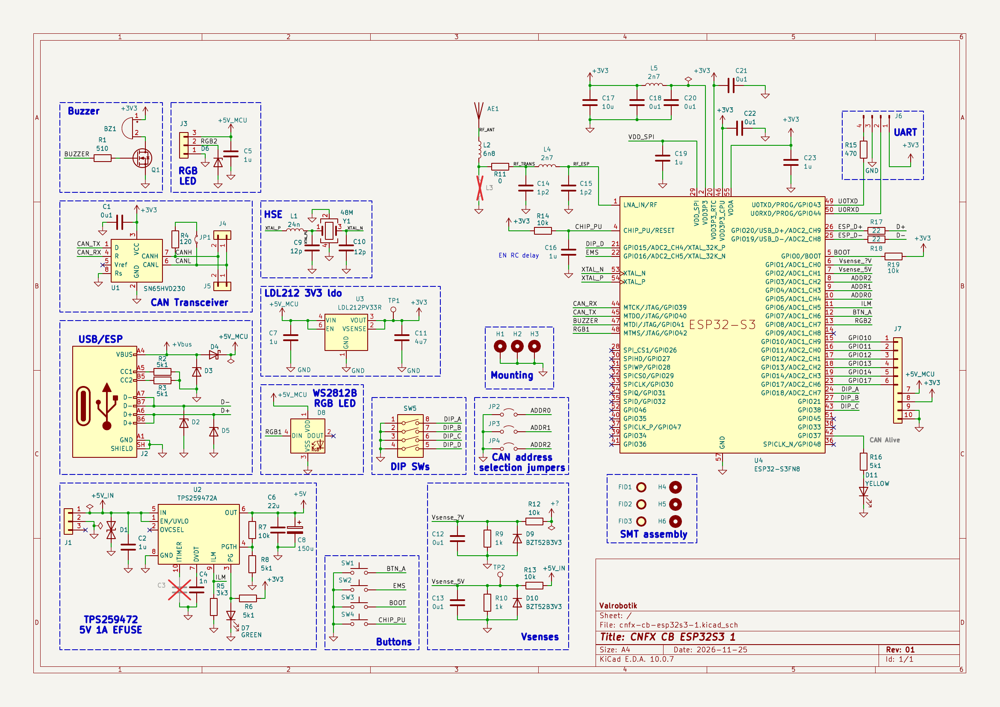

# CNFX CB ESP32S3 1

La carte de contrôle fait tourner le programme du robot. L'ESP32-S3 discute avec les autres cartes sur le bus CAN et expose ce qu'il faut pour la mise au point, avec l'USB, des boutons, un buzzer et une LED.

Elle reçoit son 5 V par J1 et le convertit en 3,3 V pour l'ESP32. Le connecteur USB-C sert à la fois à l'alimentation et à la programmation.

## Spécifications

- ESP32-S3FN8, 8 Mo de flash, Wi-Fi et Bluetooth, antenne céramique
- USB-C pour l'alimentation et l'USB natif de l'ESP32
- Transceiver CAN SN65HVD230
- Alimentation 5 V par J1, protection par eFuse TPS259472A, régulateur 3,3 V LDL212
- Buzzer magnétique et LED RGB WS2812B
- Sortie pour bandeau RGB sur JST PH 3 broches (J3)
- Entrée d'arrêt d'urgence sur JST XH 2 broches (SW2)
- DIP switch 4 bits (SW5) et cavaliers d'adresse
- Boutons BOOT, RST et BTN
- PCB en cours de conception

## Vue 3D

En cours.

## Schéma

[Télécharger le schéma complet (PDF)](/files/pcb/cnfx-cb-esp32s3-1/cnfx-cb-esp32s3-1-schematic.pdf)

## Connecteurs à souder

Le reste de la carte est déjà assemblé, seuls les connecteurs traversants sont à souder. La liste reste à confirmer tant que le PCB n'est pas finalisé.

| Référence | Connecteur | Broches | Rôle |
| --- | --- | --- | --- |
| J1 | JST XH 3 broches | 1 : +5 V, 2 : GND, 3 : non connecté | Alimentation de la carte |
| J3 | JST PH 3 broches | 1 : GND, 2 : RGB2, 3 : +5 V | Bandeau RGB |
| J4 | JST XH 2 broches | 1 : CANL, 2 : CANH | Bus CAN, entrée |
| J5 | JST XH 2 broches | 1 : CANL, 2 : CANH | Bus CAN, sortie |
| SW2 | JST XH 2 broches | 1 : GND, 2 : EMS | Arrêt d'urgence |

Un doute sur la soudure ? L'atelier [soudure](/supports-ateliers/semaine-elec/soudure) couvre les bases.

## Téléchargements

- [Schéma PDF](/files/pcb/cnfx-cb-esp32s3-1/cnfx-cb-esp32s3-1-schematic.pdf)
- [Fichiers KiCad](https://github.com/Galacs/cnfx-cb-esp32s3-1)

## Bibliothèque PlatformIO

En cours.
