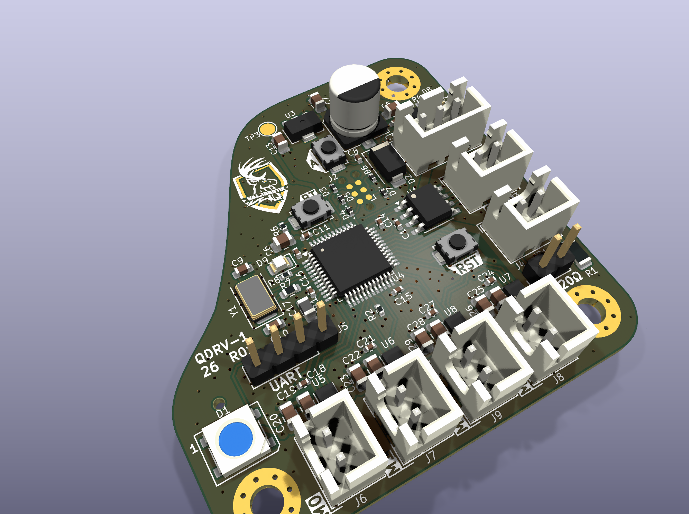
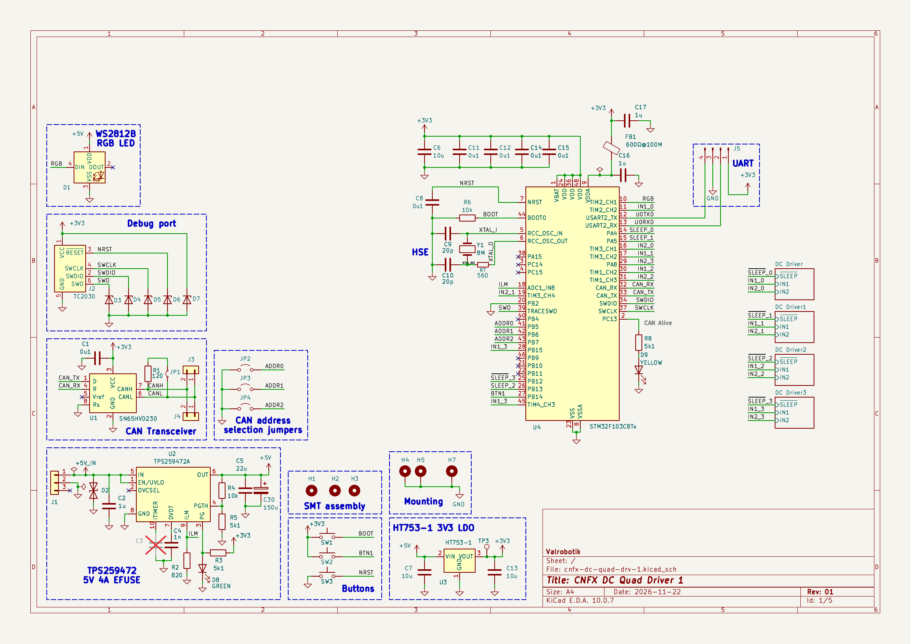

# CNFX DC Quad Driver 1

Cette carte pilote jusqu'à quatre moteurs DC et se commande depuis le bus CAN.

Elle s'alimente en 5 V via la carte d'alimentation et se place dans la chaîne CAN entre deux autres cartes.

## Spécifications

- Quatre sorties moteur, une par pont DRV8837 (1,8 A maximum par pont)
- Microcontrôleur STM32F103C8T6, Cortex-M3 à 72 MHz
- Transceiver CAN SN65HVD230
- Alimentation 5 V par J1, protection par eFuse TPS259472A, régulateur 3,3 V HT753-1
- Deux connecteurs CAN (J3 et J4) pour chaîner les cartes
- Terminaison CAN de 120 Ω activable par le cavalier JP1
- LED RGB WS2812B et deux LED d'état
- Boutons BOOT, BTN1 et NRST
- Port SWD TC2030 (J2) pour la programmation
- PCB 50 × 50 mm, 2 couches, révision 01

## Vue 3D

## Schéma

[Télécharger le schéma complet (PDF)](/files/pcb/cnfx-dc-quad-drv-1/cnfx-dc-quad-drv-1-schematic.pdf)

## Connecteurs à souder

Le reste de la carte est déjà assemblé, seuls les connecteurs traversants sont à souder.

| Référence | Connecteur | Broches | Rôle |
| --- | --- | --- | --- |
| J1 | JST XH 3 broches | 1 : +5 V, 2 : GND, 3 : non connecté | Alimentation de la carte |
| J3 | JST XH 2 broches | 1 : CANL, 2 : CANH | Bus CAN, entrée |
| J4 | JST XH 2 broches | 1 : CANL, 2 : CANH | Bus CAN, sortie |
| J6 à J9 | JST XH 2 broches | Sorties des ponts | Moteurs DC |
| J5 | Header 1×4, 2,54 mm | 1 : +3,3 V, 2 : U0RXD, 3 : GND, 4 : U0TXD | UART de debug |
| JP1 | Cavalier 1×2, 2,54 mm | Ferme la résistance de 120 Ω | Terminaison CAN |

Les cavaliers JP2, JP3 et JP4 sont des cavaliers à souder, ouverts par défaut. Ils relient les entrées ADDR0, ADDR1 et ADDR2 à la masse.

Un doute sur la soudure ? L'atelier [soudure](/supports-ateliers/semaine-elec/soudure) couvre les bases.

## Téléchargements

- [Modèle STEP](/files/pcb/cnfx-dc-quad-drv-1/cnfx-dc-quad-drv-1.step)
- [Schéma PDF](/files/pcb/cnfx-dc-quad-drv-1/cnfx-dc-quad-drv-1-schematic.pdf)
- [Fichiers KiCad](https://github.com/Galacs/cnfx-dc-quad-drv-1)

## Bibliothèque PlatformIO

En cours.
