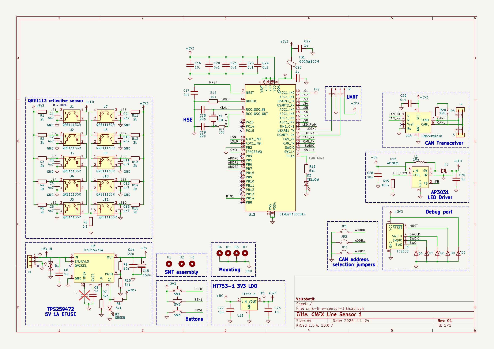

# CNFX Line Sensor 1

La carte capteurs se fixe sous le robot, face à la piste. Dix capteurs infrarouges réfléchissants lisent le contraste entre le sol et la ligne, et un STM32 envoie les valeurs sur le bus CAN.

Elle est fournie à toutes les équipes, que vous ayez pris le kit électronique complet ou seulement la carte capteurs.

## Spécifications

- Dix capteurs QRE1113GR, LED infrarouge et phototransistor
- Courant des LED réglé à 40 mA et modulation PWM
- Microcontrôleur STM32F103C8T6, Cortex-M3 à 72 MHz
- Transceiver CAN SN65HVD230
- Alimentation 5 V par J1, protection par eFuse TPS259472A, régulateur 3,3 V HT753-1
- Deux connecteurs CAN (J4 et J5) pour chaîner les cartes
- Boutons BOOT, BTN1 et NRST
- PCB en cours de conception

## Vue 3D

En cours.

## Schéma

[Télécharger le schéma complet (PDF)](/files/pcb/cnfx-line-sensor-1/cnfx-line-sensor-1-schematic.pdf)

## Connecteurs à souder

Le reste de la carte est déjà assemblé, seuls les connecteurs traversants sont à souder. La liste reste à confirmer tant que le PCB n'est pas finalisé.

| Référence | Connecteur | Broches | Rôle |
| --- | --- | --- | --- |
| J1 | JST XH 3 broches | 1 : +5 V, 2 : GND, 3 : non connecté | Alimentation de la carte |
| J4 | JST XH 2 broches | 1 : CANL, 2 : CANH | Bus CAN, entrée |
| J5 | JST XH 2 broches | 1 : CANL, 2 : CANH | Bus CAN, sortie |

Les cavaliers JP1 à JP3 règlent l'adresse CAN de la carte. JP1 vaut 1, JP2 vaut 2 et JP3 vaut 4, ce qui donne une adresse entre 0 et 7. JP4 ferme la terminaison de 120 Ω du bus. Donnez une adresse différente à chaque carte.

Un doute sur la soudure ? L'atelier [soudure](/supports-ateliers/semaine-elec/soudure) couvre les bases.

## Téléchargements

- [Schéma PDF](/files/pcb/cnfx-line-sensor-1/cnfx-line-sensor-1-schematic.pdf)
- [Fichiers KiCad](https://github.com/Galacs/cnfx-line-sensor-1)

## Bibliothèque PlatformIO

En cours.
