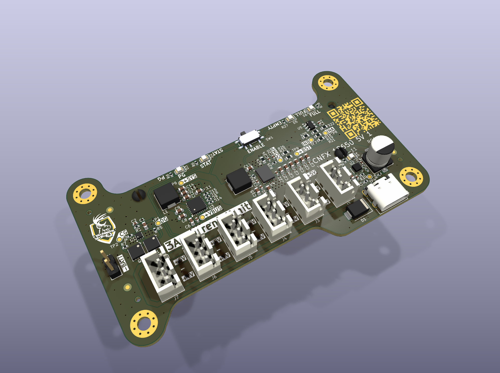
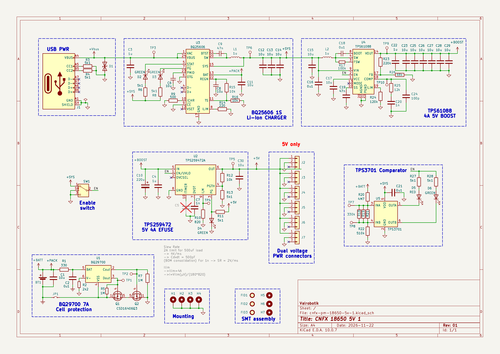

# CNFX 18650 5V 1

La carte d'alimentation fournit le 5 V à l'ensemble du robot. Elle charge et protège un accumulateur 18650, puis alimente les autres cartes par six sorties 5 V.

Elle se branche en USB-C pour la charge et devient autonome une fois le robot lancé.

## Spécifications

- Entrée USB-C 5 V, utilisée uniquement pour la charge
- Chargeur Li-ion 1S BQ25606 et protection batterie BQ29700
- Boost 5 V TPS61088, jusqu'à 4 A
- Courant limité à 3 A par l'eFuse TPS259472A
- Six sorties 5 V sur connecteur JST XH 3 broches (J2 à J7)
- Surveillance de tension par comparateur TPS3701
- Interrupteur marche/arrêt et cavalier de référence de masse (JP1)
- LED de charge, d'alimentation et d'état
- PCB 90 × 50 mm, 2 couches, révision 01

## Vue 3D

## Schéma

[Télécharger le schéma complet (PDF)](/files/pcb/cnfx-pm-18650-5v-1/cnfx-pm-18650-5v-1-schematic.pdf)

## Connecteurs à souder

Le reste de la carte est déjà assemblé, seuls les connecteurs traversants sont à souder.

| Référence | Connecteur | Broches | Rôle |
| --- | --- | --- | --- |
| J2 à J7 | JST XH 3 broches | 1 : +5 V, 2 : GND, 3 : non connecté | Sorties 5 V vers les autres cartes |
| JP1 | Cavalier 1×2, 2,54 mm | GNDREF | Référence de masse |

Le connecteur USB-C (J1) est un composant CMS, il est déjà monté.

Un doute sur la soudure ? L'atelier [soudure](/supports-ateliers/semaine-elec/soudure) couvre les bases.

## Téléchargements

- [Modèle STEP](/files/pcb/cnfx-pm-18650-5v-1/cnfx-pm-18650-5v-1.step)
- [Schéma PDF](/files/pcb/cnfx-pm-18650-5v-1/cnfx-pm-18650-5v-1-schematic.pdf)
- [Fichiers KiCad](https://github.com/Galacs/cnfx-pm-18650-5v-1)

## Bibliothèque PlatformIO

En cours.
