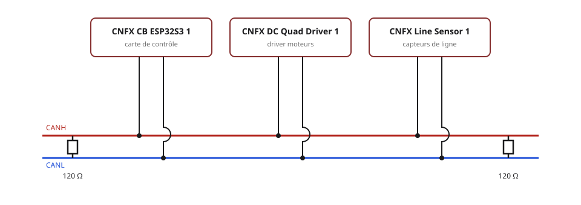
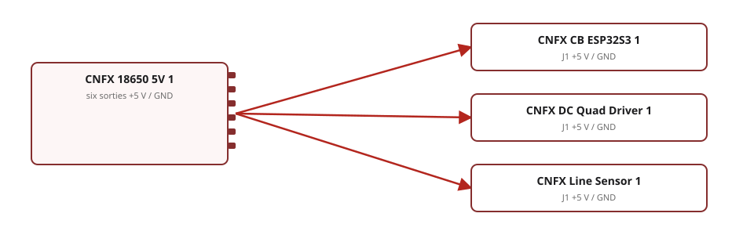

# Architecture électronique

Le kit électronique du concours est construit autour de quatre cartes. Elles communiquent par un bus CAN et partagent la même alimentation 5 V, ce qui permet de remplacer ou d'ajouter une carte sans tout recâbler.

Chaque carte a sa page avec son schéma, la liste des connecteurs à souder et ses fichiers.

## Les cartes du kit

| Carte | Rôle |
| --- | --- |
| [CNFX 18650 5V 1](/sdl/architecture/cnfx-pm-18650-5v-1) | Charge et protège la batterie, fournit le 5 V aux autres cartes. |
| [CNFX DC Quad Driver 1](/sdl/architecture/cnfx-dc-quad-drv-1) | Pilote quatre moteurs DC depuis le bus CAN. |
| [CNFX CB ESP32S3 1](/sdl/architecture/cnfx-cb-esp32s3-1) | Fait tourner le programme du robot. |
| [CNFX Line Sensor 1](/sdl/architecture/cnfx-line-sensor-1) | Lit la ligne avec dix capteurs infrarouges. |

## Le bus CAN

La carte de contrôle, le driver et la carte capteurs se parlent par un bus CAN. Il tient sur deux fils, CANH et CANL, et ces trois cartes sont branchées dessus, ce qui permet à n'importe laquelle de discuter avec les autres sans câblage dédié.

Le bus se câble en chaîne. Chacune a deux connecteurs CAN, un qui vient de la carte précédente et un qui repart vers la suivante, et on branche les cartes l'une après l'autre.

Chaque carte répond à une adresse de 0 à 7, choisie par les cavaliers ADDR0 à ADDR2. Deux cartes avec la même adresse se gênent sur le bus, donc chacune doit avoir la sienne.

:::note
Comme le kit ne contient qu'une carte de chaque type, la valeur choisie n'a pas beaucoup d'importance. Il suffit que le programme utilise la même adresse que celle réglée sur la carte. Si vous ajoutez une deuxième carte du même type, par exemple un second capteur de ligne ou un deuxième driver pour piloter plus de moteurs, donnez-leur des adresses différentes.
:::

En théorie, il faut fermer le cavalier de terminaison aux deux extrémités de la chaîne. Les cavaliers s'appellent JP1 sur la carte de contrôle et sur le driver, et JP4 sur la carte capteurs. Ils ajoutent une résistance de 120 Ω entre CANH et CANL pour absorber le signal au bout du câble et éviter qu'il reparte en écho. Les cartes du milieu laissent leur cavalier ouvert, sinon la résistance de l'ensemble devient trop faible et le bus ne fonctionne plus.

En pratique, les câbles du robot sont courts, et deux cavaliers fermés n'importe où sur la chaîne suffisent, pas forcément ceux des deux cartes aux extrémités. Il ne faut simplement pas en fermer plus. Avec des câbles plus longs, il vaut mieux revenir à une terminaison aux deux extrémités.

## L'alimentation

Le bus CAN ne transporte que les données. La carte d'alimentation n'y est pas branchée, elle sert seulement à fournir le 5 V. Chaque carte le reçoit par son connecteur J1, avec un fil +5 V et un fil GND, depuis l'une des six sorties de la carte 18650.

Le câblage d'alimentation part donc en étoile depuis la carte d'alimentation, alors que le bus CAN se chaîne de carte en carte.

:::note
Vous avez peut-être remarqué que les connecteurs d'alimentation ont trois broches. La troisième n'est pas utilisée pour l'instant. Elle est là pour transporter une autre tension que le 5 V si le kit en a besoin un jour.
:::

## Liste provisoire des composants inclus dans le kit

- Batterie 18650
- Carte d'alimentation
- Carte contrôleur de moteurs
- 2 moteurs DC
- Capteur de ligne
- Carte microcontrôleur basée sur ESP32-S3
